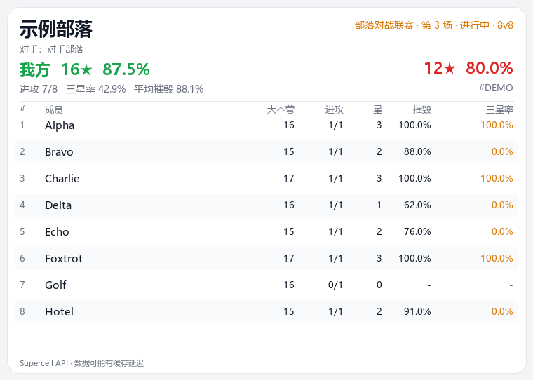
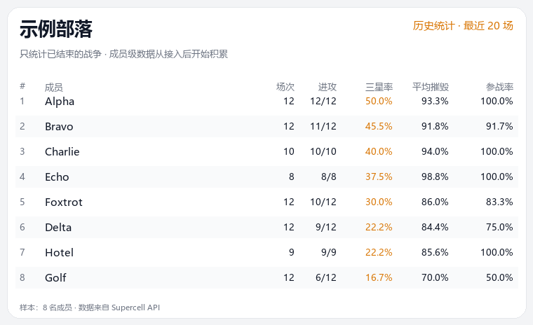

# COC Helper

国际服《部落冲突》部落战/联赛数据查询与 QQ 群机器人。

- **当前战况**：部落战/部落对战联赛、轮次、对手、星数、摧毁率、成员表
- **图片战报**：Pillow 渲染浅色卡片，纵轴严格对齐，不依赖 QQ 字体
- **历史统计**：后台 tracker 自动落库，成员三星率、平均摧毁、参战率
- **进攻明细**：每次进攻的进攻者 → 防守者、星数、摧毁率；防守者被进攻汇总
- **两种入口**：CLI 查数据；NoneBot2 + NapCat 在 QQ 私聊/群里用





> 非官方项目，与 Supercell 无关联。数据来自 Supercell 公开 API，请遵守其玩家内容政策。
> NapCat 属于第三方 QQ 协议端，建议只使用小号，并自行承担账号风控风险。

## 功能

### 当前战

- `/战况`：图片战报，含对手名、联赛第几场、大本营、进攻/三星率/摧毁率
- `/成员`：一人一行文字版，适合复制和手机查看
- `/统计`：当前战总星、三星率、平均摧毁
- `/详情`：对方成员名单 + 每次进攻明细（谁打谁、几星、多少摧毁、被进攻汇总）

### 历史

- 后台 tracker 在开战/联赛期间每 60 秒、平时每 300 秒拉取当前战并写入 `data/coc.db`
- `/报表 [N]`：最近 N 场已结束战争的成员榜（图片），按三星率排序
- `/战绩`：最近 10 场胜负
- 成员级历史从首次接入后开始积累

### CLI

```bash
python -m coc_helper.cli verify      # 验证 API / 战争日志 / 联赛
python -m coc_helper.cli war         # 当前战况 + 成员表
python -m coc_helper.cli war --save  # 手动写一次 SQLite
python -m coc_helper.cli watch       # 持续轮询（Ctrl+C 退出）
python -m coc_helper.cli history     # 已结束战争的历史统计
```

## 快速开始

### 1. 环境

- Python 3.11+
- Windows / Linux

```bash
python -m venv .venv
```

Windows：

```powershell
.venv\Scripts\activate
```

Linux / macOS：

```bash
source .venv/bin/activate
```

安装：

```bash
pip install -e ".[bot]"
```

只用 CLI 时不需要 QQ 依赖，它们都在 `[bot]` 可选依赖里。

### 2. 配置

```powershell
Copy-Item .env.example .env
```

填 `.env`：

- `COC_API_TOKEN`：在 https://developer.clashofclans.com 创建，**绑定当前公网 IP**
- `COC_CLAN_TAG`：部落标签，例如 `#2PP`
- `ONEBOT_ACCESS_TOKEN`：NapCat 和 NoneBot 共用的本地令牌
- `DRIVER` / `HOST` / `PORT`：NoneBot 反向 WebSocket 监听地址，默认 `127.0.0.1:8080`

token 不要提交到 git，也不要发群里。IP 变化后需要重新创建 key。

### 3. 验证数据源

```bash
python -m coc_helper.cli verify
python -m coc_helper.cli war
```

### 4. QQ 机器人

安装 NapCat（Windows / Linux / Docker 均可），登录小号，打开 WebUI。

在 NapCat 的“网络配置”里新建 **WebSocket 客户端（反向 WS）**：

- URL：`ws://127.0.0.1:8080/onebot/v11/ws`
- Token：与 `.env` 的 `ONEBOT_ACCESS_TOKEN` 一致

启动 bot：

```bash
python bot.py
# 或者：
bash run-bot.sh     # Linux
.\run-bot.ps1       # Windows
```

NapCat 连上后，在私聊/群里发：

| 命令 | 说明 |
|---|---|
| `/战况` | 图片战报 |
| `/成员` | 一人一行文字版 |
| `/统计` | 当前战汇总 |
| `/详情` | 对方成员 + 每次进攻明细 |
| `/报表 [N]` | 最近 N 场历史统计（图片） |
| `/战绩` | 最近 10 场胜负 |
| `/帮助` | 菜单 |

## 数据范围与限制

当前战（含 CWL 当前轮）可以拿到：

- 对方部落名、对方成员名字/大本营/进攻数据
- 每次进攻：进攻者 → 防守者、星数、摧毁率、顺序、时长
- 每个防守者被进攻次数、被打总星、最高星/摧毁
- 联赛第几场（league group 的 rounds 顺序）

历史战：

- 官方 warlog 只有部落级汇总，没有成员逐次进攻
- 成员级历史靠 tracker 在战争中轮询保存；保存过的战争，`wars.raw` 里有完整进攻明细，没保存过的拿不到
- `/详情` 目前只显示当前战，历史详情可按需扩展

拿不到的：部落竞赛分数、个人战斗日志、成员最后在线、阵型布局。

## 项目结构

```text
coc_helper/
  api.py          Supercell API 客户端（stdlib）
  config.py       .env 配置
  stats.py        成员/团队统计
  store.py        SQLite 持久化
  render.py       文字格式
  render_image.py Pillow 图片卡片
  tracker.py      后台轮询落库
  bot.py          NoneBot2 插件
  cli.py          命令行
bot.py            NoneBot2 入口
scripts/          验证、样例图片
tests/            单测
docs/             设计记录、Pi 部署、README 图片
deploy/           systemd 模板
```

## 树莓派 7×24

见 [docs/DEPLOY_PI.md](docs/DEPLOY_PI.md)。要点：

- Pi 4/5、4GB+、64 位系统；32 位跑不了 QQ NT
- Pi 在不同网络时，Supercell token 必须用它自己的公网 IP 重新创建
- Linux 装 `fonts-noto-cjk` 和 `pillow`
- 用 systemd 守护 bot，NapCat 用其安装器/服务
- SQLite 数据在 `data/coc.db`，注意备份和 SD 卡写入

## 测试

```bash
python -m unittest discover -s tests -v
```

## 设计说明

- API 客户端只用标准库 `urllib`，不依赖 `coc.py`/`clashy.py`
- CWL 当前战通过 league group + war tag 获取；普通 `/currentwar` 在联赛期间返回 `notInWar`
- 图片卡片用 Pillow 绘制，字体优先 `COC_FONT`，其次系统 CJK 字体
- 历史数据靠 tracker 累积，官方 API 不能回填成员级历史
- SQLite 开启 WAL，tracker 与 QQ 查询可同时写入

## License

MIT，见 [LICENSE](LICENSE)。

《部落冲突》名称、数据与素材归 Supercell 所有；NoneBot2、NapCat 遵循各自许可证。本项目与 Supercell 无关联。
